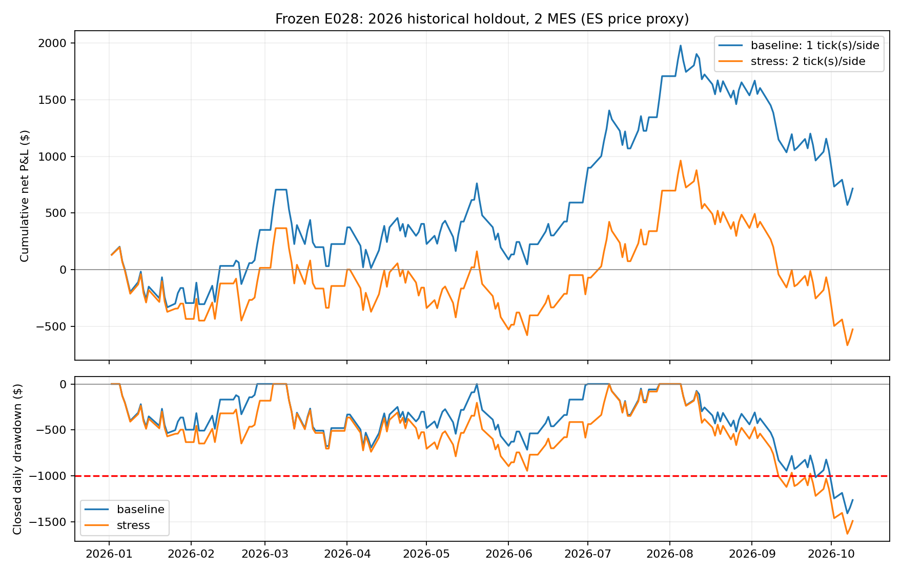

# LucidFlex 25K strategy research — completed 25 October 2026

**Decision: no strategy or fleet from this study qualified for funded deployment.**

I tested 1,025 instrument/parameter configurations, plus a smaller-position sensitivity on the original Nasdaq search. One S&P 500 configuration survived development and validation. Its rules were frozen before the 2026 historical test. It then failed: the small baseline profit disappeared under a modest slippage increase, drawdown exceeded the study's risk threshold, and uncertainty around daily returns included losses. No broker was connected, no evaluation was purchased, and no actual forward test was conducted.

## What was tested

| Branch | Configurations | Development eligible | Validated variants | Frozen candidates |
|---|---:|---:|---:|---:|
| Nasdaq one-minute signals, 2 MNQ | 297 | 1 | 0 | 0 |
| Same Nasdaq configurations at 1 MNQ (sizing sensitivity) | same 297 | 7 | 0 | 0 |
| Nasdaq 5/15-minute signals, 1 MNQ | 256 | 20 | 0 | 0 |
| Nasdaq time-based entries, 1 MNQ | 216 | 20 | 0 | 0 |
| S&P 500 5/15-minute signals, 2 MES | 256 | 18 | 2, same family | 1 |

Total distinct instrument/configuration combinations: **769 Nasdaq + 256 S&P = 1,025**. These are correlated parameter variants, not 1,025 independent trading edges. The sizing sensitivity is not counted as another 297 distinct strategies.

The four technical families were opening-range breakout, failed breakout, VWAP reversion and EMA pullback. The final Nasdaq branch used fixed-time long, short or opening-momentum entries. All search outputs, including failures, are retained.

Nasdaq development used August 2024–June 2025, validation July–December 2025. S&P history was shorter: development June–September 2025 (70 full sessions), validation October–December 2025 (62). Research branches were expanded after validation failures, so the reused validation data are not independent evidence. All branches were frozen before any 2026 strategy-performance assessment. Only the S&P survivor was then tested on January 2–October 9, 2026 (194 full sessions).

## The strongest research lead: E028 (rejected after final test)

These are its exact rules, provided for audit and reproduction, **not a deployment recommendation**:

1. Trade two Micro E-mini S&P 500 contracts (MES), long or short. The broad-history price feed is ES; P&L uses MES's $5 per point per contract.
2. At 10:00 New York time, establish the high and low of 09:30–09:59's completed one-minute bars.
3. Use completed five-minute candles anchored to 09:30. A long signal requires the current candle close above the opening-range high and the previous five-minute close at or below that high. A short requires the reverse at the opening-range low.
4. The first eligible signal is the 10:00–10:04 candle, executed at the next minute's open (10:05). Continue accepting a first signal through the 14:55–14:59 candle (15:00 entry). No entries after 15:00.
5. Stop distance is half the opening-range width, rounded up to a 0.25-point tick. Skip the signal if that distance is below 1 or above 20 ES points.
6. Stop and target are placed that distance from the actual modeled entry; target is 1R. One trade per day, no adding or averaging.
7. Exit after 120 minutes if neither stop nor target has filled; flatten by 15:55 regardless. Never hold overnight.

The model charges $1.24 per MES round trip. Baseline slippage is one tick per side; stress is two ticks per side. Both-sided slippage affects entries, exits, stop/target locations and subsequent fills, so stress results are recomputed, not merely a flat fee subtraction. Ambiguous bars resolve stop first; adverse stop gaps use the worse opening price. Target fills receive adverse slippage as an additional conservative assumption.

## Results at fixed two-MES size

All P&L is simulated, after modeled commissions and slippage, before evaluation/reset/hosting/tax costs.

| Period | Trades | Baseline net | Baseline profit factor | Closed-trade maximum drawdown | Stressed net |
|---|---:|---:|---:|---:|---:|
| Development, June–September 2025 | 68 | $843.86 | 1.394 | $297.36 | $456.36 |
| Validation, October–December 2025 | 53 | $643.56 | 1.258 | $609.84 | $233.56 |
| Untouched 2026 historical test | 158 | $715.66 | 1.082 | $1,406.62 | **−$526.84** |

Conservative drawdown measured from prior end-of-day high water to intraday trade lows was **$1,429.10 baseline / $1,656.60 stressed** in the final period. Stressed profit factor was **0.944**. The final screen required PF at least 1.10, positive baseline and stressed P&L, at least 30 trades, and conservative intraday drawdown no more than $800. E028 failed.

The 2026 baseline won 55.1% of trades but averaged only $4.53 net per trade at two contracts. Only four of ten observed months were profitable; August, September and the partial October were negative. Five-day block-bootstrap 95% intervals for mean daily P&L were −$10.78 to +$18.59 baseline and −$17.27 to +$12.17 stressed. These are descriptive intervals for the frozen test, not a multiple-search-adjusted proof of an edge.

Maximum drawdown above $1,000 does not mean every Lucid account path necessarily breaches: Lucid's floor eventually stops trailing. The separate account replays below model that cap and account resets explicitly.

## LucidFlex 25K fit and account replay

Official rules were checked on 25 October 2026. Modeled evaluation: $1,250 target; $1,000 end-of-day trailing loss allowance; 40% standard consistency; optional daily loss limit OFF. Initial floor $24,000, capped at $25,100. Intraday equity touching that active floor is treated as a breach, conservatively. A passed evaluation starts a fresh $25,000 funded account the next session.

Funded accounts have no consistency rule. First payout needs five separate days earning at least $100, positive cycle profit, a $500 minimum request and the 50%-of-profit cap. A $500 gross request is $450 to the trader at the 90% split. Requesting locks the floor at $25,100.

Primary research policy waits for $1,500 funded profit before requesting $500, preserving at least $900 of headroom after withdrawal. A separately disclosed sensitivity allows the minimum $1,000 profit, leaving only $400 initially. These are payout-policy assumptions, not extra firm requirements.

Every fifth eligible 2026 session was a historical starting point, using only starts with a complete horizon. Results are heavily overlapping and **are not independent pass/payout probability estimates**:

| Starting stage and horizon | Cost case | Eval passes | First payouts, primary reserve policy | Breaches | Still pending |
|---|---|---:|---:|---:|---:|
| Evaluation → funded, total 120 sessions | Baseline | 13/15 | 0/15 | 3 | 12 |
| Evaluation → funded, total 120 sessions | Stress | 1/15 | 0/15 | 4 | 11 |
| Already funded, 60 sessions | Baseline | N/A | 5/27 | 2 | 20 |
| Already funded, 60 sessions | Stress | N/A | 0/27 | 3 | 24 |

Evaluation and funded stages share the 120-session horizon; most baseline evaluations pass late, leaving little funded observation time. Pending is not failure. Neither baseline nor stress produced an evaluation-to-first-payout path within that horizon, even under the minimum-$1,000 payout policy.

For already-funded starts, minimum-policy payouts occurred in 15/27 baseline paths and 8/27 stressed paths; payout headroom was roughly $400–$583. The simulation stops at the first payout and does not establish survival afterward. This sensitivity does not rescue the strategy's failed final screening or establish profitable evaluation economics. Current checkout, reset and operating costs were not independently verified or included.

## Actual micro-contract check

The unchanged E028 rules were also run on contributed actual MES data covering 60 shared complete sessions from January 20–April 15, 2026. Two MES, 43 trades: baseline +$643.36 (PF 1.251), stress +$283.36 (PF 1.103). The corresponding ES-proxy results were +$535.86 / +$173.36.

This confirms that the early-period result was not solely caused by using ES prices for MES risk. It is a postselection feed/proxy check, not another independent final test; it does not cover the later deterioration or verify fills.

## Data and execution limits

- Public contributed futures bars, not an exchange-certified delivery or the user's broker feed. Main NQ source has 814,993 bars and ES 464,160; original hashes, immutable repository revision and source notes are preserved.
- Unadjusted quarterly contracts differ across providers around rollover. Indicators reset each RTH session and no positions cross sessions, reducing this issue. Contract-specific reproduction remains necessary.
- Only full 390-minute sessions are used; holidays/short sessions and data gaps are excluded. Excluding a session because of later missing data is an offline quality filter a live system cannot know in advance.
- Minute OHLC cannot resolve order inside a minute, bid/ask, queues, latency or actual protective-stop behavior. Bar-start timestamps are inferred from source convention.
- The S&P development history is short, and many alternatives were searched. Selection uncertainty is substantial even before the final failure.
- No actual forward test, broker connection, order placement or live automation is included. The research engine intentionally requires complete sessions and is not a live trading adapter.

## Files and reproduction

See `README.md` for commands. `final_results/split_metrics.csv`, `monthly_pnl.csv`, all candidate trade logs, account replay CSVs, the independent accounting audit and actual-MES check are included. Original search branches and frozen lists remain unchanged. No strategy rules or parameters were changed after opening the final test; only file paths were made portable for the research bundle.

**Conclusion:** E028 was a legitimate research lead before the final test, but its cost sensitivity and later deterioration disqualify it for the requested funded-account strategy/fleet. This study produced no funded deployment recommendation.

## Primary sources

- [LucidFlex evaluation](https://support.lucidtrading.com/en/articles/12945790-lucidflex-evaluation-account)
- [Current customization and 40%/50% consistency](https://support.lucidtrading.com/en/articles/16226050-lucidflex-customization)
- [Drawdown](https://support.lucidtrading.com/en/articles/12945815-lucidflex-drawdown)
- [Payouts](https://support.lucidtrading.com/en/articles/12945796-lucidflex-payouts)
- [Scaling](https://support.lucidtrading.com/en/articles/12945808-lucidflex-scaling-plan)
- [Commissions](https://support.lucidtrading.com/en/articles/11508978-approved-products-and-commissions)
- [Automation and other trading activities](https://support.lucidtrading.com/en/articles/11404728-other-trading-activities)
- [Inactivity policy](https://support.lucidtrading.com/en/articles/11404632-inactivity-policy)
- [Main contributed data](https://github.com/kfccolonel1/BARS)
- [Independent futures and micro-contract data](https://github.com/axb0306/cme-futures-ohlc)
